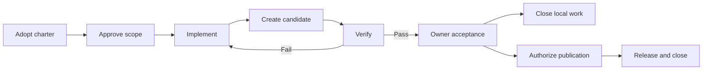

# Complete process

## 1. Adopt the charter

Identify the owner, roles, purpose, and information boundaries. Edit the template. Record `charter_adopted`, including the charter path and SHA-256 and an attributable owner reference. The checker permits one charter revision per ledger; for an amendment, use a new charter file and a new ledger linked to the preserved history. Never silently replace the adopted document.

## 2. Propose the work

Write `scope_proposed` with a unique scope ID, version, included work, exclusions, criteria, and named required checks. Do enough discovery to make the scope reviewable. Discussion and reading do not need a release cycle.

## 3. Record scoped approval

The owner records `scope_approved` referencing the proposal and the adopted charter revision. This grants ordinary edits and local verification inside that scope. A batch can cover several related changes.

For a changed scope, propose and approve a new scope ID; do not expand the old approval silently. Use `authorization_revoked` if the owner withdraws authority. Subsequent controlled events for that scope stop. Preserve completed history.

## 4. Implement

Carry out the approved work. Record decisions that matter. Open issues for problems outside scope. Record `implementation_completed` when the bounded source change exists; summarize what changed and what remains unresolved.

An interrupted session ends with truthful context, not an invented completion event. Keep the active scope and last trustworthy evidence visible.

## 5. Create an exact candidate

Package the output. Record `candidate_created` with unique candidate ID, artifact path and SHA-256. Candidates are immutable. A correction changes the candidate ID, even if the version is the same.

Store large candidates in appropriate artifact storage for a real project. This starter checker reads local artifacts. Its tiny example keeps the artifact in Git for reproducibility.

## 6. Verify

For each named required check, perform the check and preserve a report. Append `verification_recorded` with the scope/candidate, check name, result, and hashed evidence. Record FAIL, BLOCKED, or NOT_TESTED when those are the observations.

A later rerun can record a new result without deleting the failure. Acceptance requires the latest result for every required check to be PASS on the latest candidate. The owner may change requirements by approving a fresh scope, not by relabeling a failed check.

## 7. Owner acceptance

Present the concrete candidate, changes, evidence, limitations, and unresolved work. The owner records `acceptance_recorded` with result ACCEPTED or REJECTED and an attributable reference. AI-drafted acceptance text must not be logged as a human decision before that decision arrives.

The checker requires all named checks to pass, but cannot know whether the tests were adequate or reports truthful. The owner/reviewer must assess that.

## 8. Authorize and perform publication

For a local-only change, skip publication and close the scope after acceptance.

For a release/deployment, prepare the exact candidate and destination first. Record `publication_authorized` from the owner. Publish only that candidate to that destination; then record `release_recorded` with the actual location and rollback/recovery evidence.

For production systems, include migrations, backup restore checks, environment identity, rollback triggers, and observed health checks. The generic ledger uses publication to cover a release or deployment, but those operations need project-specific evidence.

## 9. Close and hand off

Record `scope_closed` after owner acceptance, and after a release receipt if publication was authorized. Carry remaining issues forward as open/deferred; closing a scope does not resolve them.

Refresh context with event IDs, accepted version/candidate, active issues, and next action. The next assistant reads the same record. No parallel ledger is created by switching tools.

## Corrections and emergencies

A `correction` references a prior event and explains the change; it preserves history and has no automatic authority effect. Reissue the relevant approval, evidence, candidate, or receipt when necessary.

An emergency does not make an assistant the owner. Follow the project's pre-authorized emergency scope or obtain an attributable owner decision. Record what occurred and verify recovery. Never declare a rollback successful merely because the command was prepared.

## Practical overhead

One approved scope, one candidate, named meaningful checks, and one acceptance event are enough for a small local change. Do not create events for every keystroke, search, or routine command. Use release/deployment controls when those actions actually occur.
